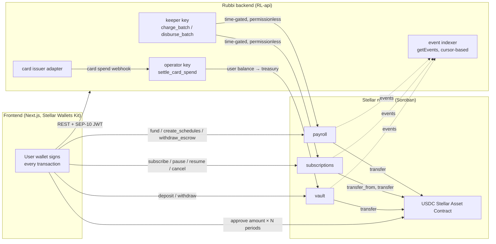

# Rubbi smart contracts

Soroban contracts for [Rubbi](https://github.com/RubbiLabs), a payment
automation platform for users in Nigeria. Users fund a dollar balance in USDC,
pay recurring subscriptions and bills, run recurring payroll for their staff,
and spend through a virtual card. These three contracts hold the on-chain side
of that product:

| Contract | Purpose | Custody |
|---|---|---|
| [`vault`](contracts/vault) | USDC balance that funds the user's card; card spends are settled on-chain by Rubbi's operator | custodial (card funding only) |
| [`subscriptions`](contracts/subscriptions) | recurring subscription and bill payments pulled from the subscriber's own wallet | non-custodial (bounded, expiring allowance) |
| [`payroll`](contracts/payroll) | employer-funded escrow that pays recurring salaries | employer escrow |

The backend lives in [RL-api](https://github.com/RubbiLabs/RL-api) and the
web app in [RL-frontend](https://github.com/RubbiLabs/RL-frontend).

## Why Stellar

- **Native USDC.** Circle issues USDC on Stellar as a first-class asset
  ([issuer addresses](https://developers.circle.com/stablecoins/usdc-contract-addresses)).
  Soroban contracts use it through its
  [Stellar Asset Contract](https://developers.stellar.org/docs/tokens/stellar-asset-contract)
  (SAC), so Rubbi needs no bridged or wrapped dollar and no token of its own.
- **Fast, cheap settlement.** Ledgers close about every 5 seconds (measured on
  2026-10-27: 100 ledgers in 500 s on both testnet and mainnet) and the
  network minimum inclusion fee is 100 stroops (0.00001 XLM) per operation
  ([fees](https://developers.stellar.org/docs/learn/fundamentals/fees-resource-limits-metering)).
  A salary run or a batch of subscription charges costs cents, not dollars.
- **Anchors for local on/off-ramps.**
  [Anchors](https://developers.stellar.org/docs/learn/fundamentals/anchors)
  connect Stellar to local banking rails through standard protocols
  (SEP-24, SEP-31), which is how naira moves in and out of a USDC balance
  without Rubbi running its own exchange.
- **Standard wallet auth.** Users sign in with
  [SEP-10](https://github.com/stellar/stellar-protocol/blob/master/ecosystem/sep-0010.md)
  and sign transactions in their own wallet; no key ever reaches Rubbi's
  servers or the browser.

## Architecture



Money never sits in the backend. The frontend talks to the contracts directly
with the user's wallet; the backend only (a) calls the permissionless,
time-gated `charge_batch` / `disburse_batch` with its keeper key, (b) settles
card spends with its operator key, and (c) mirrors contract events into its
database for the app's lists and history.

## Conventions shared by all three contracts

- `#![no_std]`, [soroban-sdk](https://docs.rs/soroban-sdk) 29.0.1, built with
  `stellar contract build` for `wasm32v1-none`.
- Amounts are `i128` in the asset's smallest unit. USDC has 7 decimals on
  Stellar: `1_0000000` = 1 USDC. Every amount-taking function rejects
  `amount <= 0` with `InvalidAmount`.
- Time is `env.ledger().timestamp()` in seconds. Periods are `u64` seconds
  between 1 day (`86_400`) and 366 days.
- One `#[contracterror]` enum per contract with stable numeric codes (tables
  below). Expected failures return `Err`; contracts never panic on user input.
  Authorization failures are host-level `require_auth` failures, not contract
  error codes.
- Initialization happens in `__constructor`, so a contract is configured in
  the same transaction that creates it and cannot be front-run.
- Admin model: `propose_admin` / `accept_admin` (two-step transfer),
  `pause` / `unpause`, `upgrade(new_wasm_hash)` (admin-only, storage kept).
- Pause blocks new money coming in and automated charges going out. It never
  blocks a user from withdrawing their own funds or cancelling.
- Storage: configuration in instance storage, per-user and per-entity data in
  persistent storage. Instance TTL is extended to 30 days on every
  state-changing call; persistent entries to 90 days on every read and write
  (see each `storage.rs`; `DAY_IN_LEDGERS = 17_280` from the 5 s close time).
- Every state change emits a typed `#[contractevent]`. The first topic is the
  event name (snake case), the second topic is the primary address (user,
  subscriber, merchant or employer) where there is one, so an indexer can
  filter by contract, event and address.
- Order of operations: checks → effects (storage writes) → interactions
  (token transfers).
- Batch functions accept at most 25 items (`MAX_BATCH`). No contract keeps an
  unbounded list; listing is the indexer's job, contracts expose `get_*` by id.

## Contract reference

### vault

Custody for card funding. `__constructor(admin, operator, treasury, token)`.

| Function | Auth | Errors | Events |
|---|---|---|---|
| `deposit(user, amount)` | `user` | `InvalidAmount`, `Paused`, `Overflow` | `deposit` |
| `withdraw(user, amount)` — allowed while paused | `user` | `InvalidAmount`, `InsufficientBalance` | `withdraw` |
| `settle_card_spend(user, amount, reference: BytesN<32>)` — moves the user's balance to the treasury; `reference` is unique | operator | `InvalidAmount`, `Paused`, `DuplicateReference`, `InsufficientBalance`, `Overflow` | `card_spend_settled` |
| `credit_refund(user, amount, reference: BytesN<32>)` — treasury → vault, credits the user; own reference namespace; allowed while paused | treasury | `InvalidAmount`, `DuplicateReference`, `Overflow` | `refund_credited` |
| `set_operator(new_operator)` | admin | — | `operator_set` |
| `set_treasury(new_treasury)` | admin | — | `treasury_set` |
| `propose_admin(new_admin)` | admin | — | `admin_proposed` |
| `accept_admin()` | pending admin | `NoPendingAdmin` | `admin_transferred` |
| `pause()` / `unpause()` | admin | — | `paused` / `unpaused` |
| `upgrade(new_wasm_hash)` | admin | — (host fails if the wasm is not uploaded) | `upgraded` |
| `balance(user)`, `total_balances()`, `admin()`, `pending_admin()`, `operator()`, `treasury()`, `token()`, `is_paused()` | none | — | — |

Invariant: `sum(balance(*)) == total_balances() == vault's USDC balance` as
long as nobody transfers USDC to the vault directly. A failed settlement
(e.g. insufficient balance) does not consume its reference.

### subscriptions

Non-custodial recurring payments. `__constructor(admin, token, fee_recipient, fee_bps)`
(`fee_bps > 1_000` fails with `FeeTooHigh`).

Types (no personal data is stored, enforced by a test that decodes the
contract spec):

```rust
pub struct Merchant { pub payout: Address, pub active: bool }
pub struct Plan { pub id: u32, pub merchant: Address, pub name: String /* ≤ 64 bytes */, pub amount: i128, pub period: u64, pub active: bool }
pub enum SubStatus { Active, Paused, PastDue, Cancelled }
pub struct Subscription { pub id: u64, pub subscriber: Address, pub plan_id: u32, pub next_due: u64, pub status: SubStatus, pub created_at: u64 }
```

| Function | Auth | Errors | Events |
|---|---|---|---|
| `add_merchant(merchant, payout)` — `payout` must already be able to receive USDC (trustline open) | admin | `MerchantExists`, `PayoutUnavailable` | `merchant_added` |
| `set_merchant_active(merchant, active)` — inactive merchants cannot create plans or take subscribers; their subscriptions are skipped by `charge` | admin | `MerchantNotFound` | `merchant_active_set` |
| `create_plan(merchant, name, amount, period) -> u32` | `merchant` (active) | `MerchantNotFound`, `MerchantInactive`, `NameTooLong`, `InvalidAmount`, `InvalidPeriod` | `plan_created` |
| `set_plan_active(merchant, plan_id, active)` — deactivated plans take no new subscribers; existing ones keep running | `merchant` (plan owner) | `PlanNotFound`, `NotPlanOwner` | `plan_active_set` |
| `subscribe(subscriber, plan_id) -> u64` — pulls the first period immediately; nothing is written if the pull fails or the payout address cannot receive USDC | `subscriber` | `Paused`, `PlanNotFound`, `PlanInactive`, `MerchantNotFound`, `MerchantInactive`, `AlreadySubscribed`, `PayoutUnavailable`, `PaymentFailed`, `Overflow` | `subscribed`, `charged` |
| `charge(sub_id) -> bool` — one period if due; `false` + `PastDue` on a failed pull; `false` + nothing written (no pull, allowance untouched) for an inactive merchant or a payout address that cannot receive USDC | none | `Paused`, `SubscriptionNotFound`, `NotChargeable`, `NotDue`, `PlanNotFound`, `MerchantNotFound`, `Overflow` | `charged`, `charge_failed` or `charge_skipped` |
| `charge_batch(sub_ids) -> Vec<bool>` — per-item problems yield `false`, never fail the batch; one unpayable merchant never blocks the others | none | `BatchTooLarge`, `Paused` | as `charge`, per item |
| `pause_subscription(subscriber, sub_id)` — allowed while the contract is paused | `subscriber` | `SubscriptionNotFound`, `NotSubscriber`, `NotPausable` | `subscription_paused` |
| `resume_subscription(subscriber, sub_id)` — `next_due = max(next_due, now)`; allowed while paused | `subscriber` | `SubscriptionNotFound`, `NotSubscriber`, `NotPaused` | `subscription_resumed` |
| `cancel_subscription(subscriber, sub_id)` — final, frees the plan slot; allowed while paused | `subscriber` | `SubscriptionNotFound`, `NotSubscriber`, `AlreadyCancelled` | `subscription_cancelled` |
| `set_fee(fee_bps)` | admin | `FeeTooHigh` | `fee_set` |
| `set_fee_recipient(fee_recipient)` | admin | — | `fee_recipient_set` |
| `propose_admin(new_admin)` / `accept_admin()` | admin / pending admin | — / `NoPendingAdmin` | `admin_proposed` / `admin_transferred` |
| `pause()` / `unpause()` — pause blocks `subscribe`, `charge`, `charge_batch` | admin | — | `paused` / `unpaused` |
| `upgrade(new_wasm_hash)` | admin | — | `upgraded` |
| `get_merchant(merchant) -> Option<Merchant>`, `get_plan(plan_id)`, `get_subscription(sub_id)`, `sub_id_of(subscriber, plan_id) -> Option<u64>`, `admin()`, `pending_admin()`, `token()`, `fee_recipient()`, `fee_bps()`, `is_paused()` | none | `PlanNotFound` / `SubscriptionNotFound` for the two `get_*` by id | — |

State machine: pause from `Active` or `PastDue`; resume only from `Paused`;
cancel from anything but `Cancelled`. Ids start at 1; rejected calls never
consume an id.

### payroll

Employer-funded escrow. `__constructor(admin, token, fee_recipient, fee_bps)`
(`fee_bps > 1_000` fails with `FeeTooHigh`).

```rust
pub enum ScheduleStatus { Active, Paused, Cancelled }
pub struct ScheduleInput { pub recipient: Address, pub amount: i128, pub period: u64, pub label: String /* ≤ 64 bytes */ }
pub struct Schedule { pub id: u64, pub employer: Address, pub recipient: Address, pub amount: i128, pub period: u64, pub next_due: u64, pub status: ScheduleStatus, pub label: String, pub created_at: u64 }
```

| Function | Auth | Errors | Events |
|---|---|---|---|
| `fund(employer, amount)` | `employer` | `InvalidAmount`, `Paused`, `Overflow` | `funded` |
| `withdraw_escrow(employer, amount)` — allowed while paused | `employer` | `InvalidAmount`, `InsufficientEscrow` | `escrow_withdrawn` |
| `create_schedules(employer, inputs, first_due) -> Vec<u64>` — up to 25 inputs, all first due at `first_due >= now`; validates everything before writing anything | `employer` | `Paused`, `TooManySchedules`, `FirstDueInPast`, `InvalidAmount`, `InvalidPeriod`, `LabelTooLong` | one `schedule_created` per schedule (without the label; read it with `get_schedule`) |
| `disburse(schedule_id) -> bool` — pays exactly one period if due; `false` and nothing written when the employer's escrow is short (`disburse_failed`, `insufficient_escrow`) or the recipient cannot receive USDC (`disburse_failed`, `recipient_unpayable`) | none | `Paused`, `ScheduleNotFound`, `NotActive`, `NotDue`, `Overflow` | `disbursed` or `disburse_failed` |
| `disburse_batch(ids) -> Vec<bool>` — per-item problems yield `false`; one unpayable recipient never blocks the others | none | `BatchTooLarge`, `Paused` | as `disburse`, per item |
| `pause_schedule(employer, schedule_id)` — `next_due` is not moved: owed salary stays owed; allowed while paused | `employer` | `ScheduleNotFound`, `NotEmployer`, `NotActive` | `schedule_paused` |
| `resume_schedule(employer, schedule_id)` — keeps `next_due`; allowed while paused | `employer` | `ScheduleNotFound`, `NotEmployer`, `NotPaused` | `schedule_resumed` |
| `cancel_schedule(employer, schedule_id)` — final; the shared escrow is untouched; allowed while paused | `employer` | `ScheduleNotFound`, `NotEmployer`, `AlreadyCancelled` | `schedule_cancelled` |
| `set_fee(fee_bps)` | admin | `FeeTooHigh` | `fee_set` |
| `set_fee_recipient(fee_recipient)` | admin | — | `fee_recipient_set` |
| `propose_admin(new_admin)` / `accept_admin()` | admin / pending admin | — / `NoPendingAdmin` | `admin_proposed` / `admin_transferred` |
| `pause()` / `unpause()` — pause blocks `fund`, `create_schedules`, `disburse`, `disburse_batch` | admin | — | `paused` / `unpaused` |
| `upgrade(new_wasm_hash)` | admin | — | `upgraded` |
| `get_schedule(schedule_id)`, `escrow_of(employer)`, `total_escrow()`, `admin()`, `pending_admin()`, `token()`, `fee_recipient()`, `fee_bps()`, `is_paused()` | none | `ScheduleNotFound` for `get_schedule` | — |

Invariant: `sum(escrow_of(*)) == total_escrow() == payroll's USDC balance`
as long as nobody transfers USDC to the contract directly.

## Error codes

Codes are stable and part of the public interface: clients map them to
messages. The tables below are generated from each contract's `errors.rs`;
`scripts/check-readme-errors.sh` fails CI when they drift (`--write`
regenerates them).

### vault

<!-- errors:vault:start -->
| Code | Name | Meaning |
|---|---|---|
| 1 | `InvalidAmount` | The amount is zero or negative. |
| 2 | `InsufficientBalance` | The user's vault balance is smaller than the requested amount. |
| 3 | `Paused` | The contract is paused and this operation is blocked while paused. |
| 4 | `DuplicateReference` | A spend or refund reference was already used (idempotency guard). |
| 5 | `NoPendingAdmin` | `accept_admin` was called while no admin transfer is pending. |
| 6 | `Overflow` | An arithmetic operation would overflow. |
<!-- errors:vault:end -->

### subscriptions

<!-- errors:subscriptions:start -->
| Code | Name | Meaning |
|---|---|---|
| 1 | `InvalidAmount` | The amount is zero or negative. |
| 2 | `Paused` | The contract is paused and this operation is blocked while paused. |
| 3 | `FeeTooHigh` | `fee_bps` exceeds the hard cap of 1_000 (10%). |
| 4 | `InvalidPeriod` | The period is shorter than 1 day or longer than 366 days. |
| 5 | `NameTooLong` | The plan name is longer than 64 bytes. |
| 6 | `MerchantExists` | `add_merchant` was called for an address that is already a merchant. |
| 7 | `MerchantNotFound` | The address is not on the merchant allowlist. |
| 8 | `MerchantInactive` | The merchant is deactivated: it cannot create plans or take new subscribers. |
| 9 | `PlanNotFound` | No plan with this id exists. |
| 10 | `PlanInactive` | The plan is deactivated and accepts no new subscribers. |
| 11 | `NotPlanOwner` | The caller is not the merchant that owns the plan. |
| 12 | `AlreadySubscribed` | The subscriber already has a non-cancelled subscription to this plan. |
| 13 | `SubscriptionNotFound` | No subscription with this id exists. |
| 14 | `NotSubscriber` | The caller is not the owner of the subscription. |
| 15 | `NotDue` | The subscription's `next_due` is in the future. |
| 16 | `NotChargeable` | The subscription is paused or cancelled and cannot be charged. |
| 17 | `NotPausable` | Only `Active` or `PastDue` subscriptions can be paused. |
| 18 | `NotPaused` | Only `Paused` subscriptions can be resumed. |
| 19 | `AlreadyCancelled` | The subscription is already cancelled. |
| 20 | `PaymentFailed` | The first-period pull in `subscribe` failed (allowance or balance). |
| 21 | `BatchTooLarge` | A batch has more than `MAX_BATCH` (25) items. |
| 22 | `NoPendingAdmin` | `accept_admin` was called while no admin transfer is pending. |
| 23 | `Overflow` | An arithmetic operation would overflow. |
| 24 | `PayoutUnavailable` | The merchant's payout address cannot receive USDC: it has no USDC trustline, or the trustline is frozen. |
<!-- errors:subscriptions:end -->

### payroll

<!-- errors:payroll:start -->
| Code | Name | Meaning |
|---|---|---|
| 1 | `InvalidAmount` | The amount is zero or negative. |
| 2 | `Paused` | The contract is paused and this operation is blocked while paused. |
| 3 | `FeeTooHigh` | `fee_bps` exceeds the hard cap of 1_000 (10%). |
| 4 | `InvalidPeriod` | The period is shorter than 1 day or longer than 366 days. |
| 5 | `LabelTooLong` | The schedule label is longer than 64 bytes. |
| 6 | `InsufficientEscrow` | The employer's escrow is smaller than the requested withdrawal. |
| 7 | `TooManySchedules` | `create_schedules` was called with more than 25 inputs. |
| 8 | `FirstDueInPast` | `first_due` is in the past. |
| 9 | `ScheduleNotFound` | No schedule with this id exists. |
| 10 | `NotEmployer` | The caller is not the employer that owns the schedule. |
| 11 | `NotActive` | The schedule is not `Active` (paused or cancelled). |
| 12 | `NotPaused` | Only `Paused` schedules can be resumed. |
| 13 | `AlreadyCancelled` | The schedule is already cancelled. |
| 14 | `NotDue` | The schedule's `next_due` is in the future. |
| 15 | `BatchTooLarge` | A batch has more than `MAX_BATCH` (25) items. |
| 16 | `NoPendingAdmin` | `accept_admin` was called while no admin transfer is pending. |
| 17 | `Overflow` | An arithmetic operation would overflow. |
<!-- errors:payroll:end -->

## Security model and trust assumptions

**Roles.** Five keys with separate powers; compromising one does not grant
another's.

| Role | Holds | Can |
|---|---|---|
| admin | Rubbi (multisig recommended) | rotate operator / treasury, set fees (hard cap 10%) and fee recipient, allowlist merchants, pause / unpause, upgrade, hand over admin with a two-step transfer |
| operator | Rubbi backend (hot key) | `settle_card_spend` only |
| treasury | Rubbi | receives settled card spends; signs `credit_refund` |
| keeper | Rubbi backend (hot key) | nothing special: `charge_batch` and `disburse_batch` are permissionless and time-gated, the keeper just pays the fees |
| fee recipient | Rubbi | receives the fee share of every charge and disbursement; no powers |

**Custodial card settlement.** The vault is custodial for card funding: the
operator key can move *any* user's vault balance to the treasury via
`settle_card_spend`. Users trust Rubbi's backend to settle only real card
spends. Idempotent references and events make every settlement auditable,
but they do not stop a compromised operator from draining vault balances up
to each user's balance. Keep the operator key in the backend only, rotate it
with `set_operator`, and keep the treasury key separate.

**Users can always withdraw.** Pausing the vault blocks deposits and
settlements but never `withdraw`; pausing payroll never blocks
`withdraw_escrow`; subscribers can pause, resume and cancel while the
subscriptions contract is paused. Refunds (treasury → user) also work while
paused.

**Subscriptions can only pull what was approved.** The contract holds no
funds and has no allowance of its own. It can pull at most the amount the
subscriber approved on the USDC SAC, and that allowance expires at the
`live_until_ledger` the subscriber chose. A merchant cannot raise a plan's
price for existing subscribers (plans are immutable apart from `active`).

**Payroll escrow only goes to the employer's own recipients, or back to
the employer.** `disburse` pays the recipient and the fee recipient of a
schedule the employer created; `withdraw_escrow` returns funds to the
employer. Nobody else can move escrow. Schedules are per-employer and only
their employer can pause, resume or cancel them.

**Admin powers and their limits.** The admin can pause, change fees (never
above 1_000 bps = 10%), rotate roles, and `upgrade` the contract code in
place (storage is kept). An upgrade can change any rule, so the admin key is
the root of trust; a timelock on upgrades is a planned follow-up.

**Permissionless keepers.** Anyone may call `charge`, `charge_batch`,
`disburse`, `disburse_batch`. They are time-gated per item and pay exactly
one period, so a third-party caller can only make a payment happen on time,
never early or twice.

**One payee never blocks the others.** A merchant payout address or payroll
recipient that cannot receive USDC (see "USDC trustlines") makes only its
own item return `false`, with no state change and no funds moved; the rest
of the batch is paid. In subscriptions the check runs before the pull, so
the subscriber's allowance is never consumed for a merchant that cannot be
paid.

## Money rules

### Fees

`fee = amount * fee_bps / 10_000`, rounded down. The payer (subscriber or
employer escrow) always pays exactly `amount`; the payee receives
`amount - fee` and the fee recipient receives `fee`. `fee_bps` is set per
contract by the admin, capped at 1_000 (10%). Testnet deploys with
`fee_bps = 50` (0.5%). The vault charges no fee.

### Subscription allowance model

Funds stay in the subscriber's wallet. Before `subscribe`, the subscriber
calls `approve(from = subscriber, spender = subscriptions contract, amount =
plan.amount × N, live_until_ledger)` on the USDC SAC. The frontend defaults
to **N = 3** periods and computes `live_until_ledger` to cover them (at
17 280 ledgers per day). Each `charge` pulls one `plan.amount` with
`transfer_from`. When the allowance is used up or expired, `charge` marks the
subscription `PastDue` and returns `false` instead of failing; the next
`charge` after the subscriber re-approves succeeds and sets it back to
`Active`. Subscribers can see "covers N more payments / expires at ledger L"
from the allowance alone.

### No back-charging (subscriptions) vs back pay (payroll)

- **Subscriptions never back-charge.** After a successful charge
  `next_due += period`; if that is still in the past, `next_due = now +
  period`. A subscriber who was past due for three months is charged once.
- **Payroll always back-pays.** Each `disburse` pays exactly one period and
  advances `next_due` by exactly one period. N missed periods are paid by N
  calls (each time-gated), and the (N+1)th call fails with `NotDue`.
  Pausing a schedule does not move `next_due`: owed salary stays owed.

### Batches

`charge_batch` and `disburse_batch` take up to 25 ids and return one `bool`
per id in input order. A per-item problem (not due, paused or cancelled,
unknown id, inactive merchant, unpayable payout address or recipient, failed
pull, short escrow) yields `false` for that item and never fails the batch;
only `BatchTooLarge` and `Paused` fail the whole call. Items skipped for
"not due", "not chargeable/active" or "unknown id" emit no event; the other
cases emit `charge_failed`, `charge_skipped` (`merchant_inactive` or
`payout_unavailable`) or `disburse_failed` (`insufficient_escrow` or
`recipient_unpayable`).

### Why 25

`MAX_BATCH = 25` and `MAX_SCHEDULES_PER_CALL = 25`. A Soroban transaction may
emit at most 16 384 bytes of contract events and write at most 200 ledger
entries (`tx_max_contract_events_size_bytes`, `tx_max_write_ledger_entries`;
read from the live network configuration of testnet and mainnet on
2026-10-27, identical on both). `create_schedules` emits one
`schedule_created` event per schedule: 25 schedules use about 7 800 bytes of
events and 27 write entries, i.e. under half of the events limit; 50 would
have used 98% of it. Larger payrolls are created in several calls.

### USDC trustlines

Classic Stellar accounts (`G...`) can only hold USDC after opening a
trustline to the issuer (`change_trust`). The SAC fails any `transfer` to,
and any `balance` or `authorized` read of, an account without one
(`Error(Contract, #13)`, "trustline entry is missing for account", verified
on testnet on 2026-10-27); it also rejects transfers to a trustline the
issuer has frozen (Circle's issuer has `auth_revocable` set) or that would
exceed the trustline's limit. Contract addresses (`C...`) hold SAC balances
without trustlines. Therefore:

- the **treasury** and the **fee recipient** need a USDC trustline before
  the first settlement, charge or disbursement. `scripts/deploy-testnet.sh`
  creates both, and `scripts/smoke-testnet.sh` checks them. The fee
  recipient is admin-controlled, so the contracts pay it with a plain
  `transfer`: if its trustline were ever missing or frozen, every `charge`
  and `disburse` would abort as a whole until it is fixed.
- every **merchant payout address** must have its USDC trustline open
  **before `add_merchant`**: the contract checks it (`authorized` on the
  SAC) and rejects the merchant with `PayoutUnavailable` otherwise. The same
  check runs in `subscribe` (error `PayoutUnavailable`) and before every
  `charge`: a merchant whose payout address can no longer receive USDC makes
  the charge return `false` with `charge_skipped` (`payout_unavailable`),
  nothing pulled, the subscriber's allowance untouched, no `PastDue`, and
  `next_due` unchanged. Charging resumes once the address can receive USDC.
- every **payroll recipient** that is a regular account must have its USDC
  trustline open **before its first disbursement**. `disburse` pays the
  recipient with `try_transfer` before writing anything: a recipient that
  cannot receive USDC makes that item return `false` with `disburse_failed`
  (`recipient_unpayable`), escrow, totals and `next_due` unchanged, so the
  period stays owed and is paid as soon as the trustline exists.

Residual cases the subscriptions pre-check does not cover, because
`authorized` cannot see them: a payout trustline whose **limit** the payment
would exceed, and this contract's own USDC balance being **frozen** by the
issuer. Both still abort the whole `charge` or `charge_batch` with a host
error (the subscriber's allowance is not consumed, since the whole
transaction reverts). Payroll's `try_transfer` covers every recipient-side
cause. The keeper (Phase 4) must therefore retry a failed batch item by item
so that one such item cannot hold up the others.

On testnet, get XLM from Friendbot (`stellar keys fund <name> --network
testnet`, or [Stellar Lab](https://lab.stellar.org/account/fund)) and USDC
from [Circle's faucet](https://faucet.circle.com/) ("Stellar Testnet").

## Build and test

From a clean machine:

```sh
# Rust: rustup installs the pinned toolchain (1.99.1) and wasm32v1-none
# target automatically from rust-toolchain.toml.
curl --proto '=https' --tlsv1.2 -sSf https://sh.rustup.rs | sh

# stellar CLI 28.1.0 (macOS/Linux)
brew install stellar-cli            # or: cargo install --locked stellar-cli@28.1.0

# optional, for the scripts and CI parity
brew install shellcheck jq          # or your distro's packages

git clone https://github.com/RubbiLabs/RL-smart-contracts.git
cd RL-smart-contracts

cargo fmt --all --check
cargo clippy --all-targets -- -D warnings
cargo test --workspace
stellar contract build
# positive upgrade-path tests; they need the wasm built by the previous command
cargo test -p rubbi-vault --features wasm-upgrade-test
cargo test -p rubbi-subscriptions --features wasm-upgrade-test
cargo test -p rubbi-payroll --features wasm-upgrade-test
shellcheck scripts/*.sh
scripts/check-readme-errors.sh
```

The optimized contracts are written to `target/wasm32v1-none/release/`
(`rubbi_vault.wasm`, `rubbi_subscriptions.wasm`, `rubbi_payroll.wasm`).
`stellar contract info hash --wasm <file>` prints the hash that
`deployments/*.json` records. CI (`.github/workflows/ci.yml`) runs the same
commands on every push and pull request.

## Deploy to testnet

The deploy script uses stellar CLI identities by name and never reads,
prints or logs a secret key. Nothing in this repository contains a key.

1. **Create and fund the five identities** (once):

   ```sh
   for name in rubbi-admin rubbi-operator rubbi-treasury rubbi-keeper rubbi-fees; do
     stellar keys generate "$name" --network testnet --fund
   done
   ```

   | Identity | Role |
   |---|---|
   | `rubbi-admin` | admin of all three contracts; signs the deployment |
   | `rubbi-operator` | vault operator (card settlement) |
   | `rubbi-treasury` | vault treasury (receives settlements, funds refunds) |
   | `rubbi-keeper` | backend key that calls `charge_batch` / `disburse_batch` (recorded, not used by the contracts) |
   | `rubbi-fees` | fee recipient of subscriptions and payroll |

2. **Dry run.** Prints every command (public addresses only) and deploys
   nothing:

   ```sh
   scripts/deploy-testnet.sh --dry-run
   ```

3. **Deploy.** The script checks the identities, resolves the USDC SAC from
   the issuer (`USDC_ISSUER`, default: Circle's testnet issuer
   `GBBD47IF6LWK7P7MDEVSCWR7DPUWV3NY3DTQEVFL4NAT4AQH3ZLLFLA5`), opens USDC
   trustlines for `rubbi-treasury` and `rubbi-fees` if they are missing
   (`change_trust` signed by each identity), builds, deploys the three
   contracts with their constructor arguments signed by `rubbi-admin`, and
   writes `deployments/testnet.json`:

   ```sh
   scripts/deploy-testnet.sh
   ```

   Constructor arguments: vault `(admin, operator, treasury, token = USDC
   SAC)`; subscriptions and payroll `(admin, token = USDC SAC, fee_recipient
   = rubbi-fees, fee_bps = 50)`.

   If `deployments/testnet.json` already exists the script refuses to run.
   `--force` redeploys after copying the current file to
   `deployments/testnet.<timestamp>.json`, so earlier contract ids are never
   lost. `deployments/testnet.example.json` shows the file's shape.

4. **Smoke test.** Read-only simulations (nothing is signed or submitted)
   that compare every contract's `admin`, `operator`, `treasury`, `token`,
   `fee_recipient`, `fee_bps`, `is_paused`, totals and deployed wasm hash
   against the deployment record, and check the two USDC trustlines:

   ```sh
   scripts/smoke-testnet.sh            # SMOKE_SOURCE=<identity> to simulate as another account
   ```

5. Commit `deployments/testnet.json` and fill in the table below.

6. **Trustlines for payees.** Before `add_merchant`, the merchant's payout
   address must hold a USDC trustline (the call fails with
   `PayoutUnavailable` otherwise); a payroll recipient that is a regular
   account needs one before its first disbursement (until then each
   `disburse` returns `false` with `disburse_failed`, `recipient_unpayable`,
   and the period stays owed). Check and open one with the CLI, signed by
   the payee:

   ```sh
   stellar ledger entry fetch trustline --account <G-address> --asset USDC:<issuer> --network testnet --output json
   stellar tx new change-trust --source-account <payee-identity> --line USDC:<issuer> --network testnet
   ```

## Testnet deployments

Network passphrase `Test SDF Network ; September 2015`, RPC
`https://soroban-testnet.stellar.org`.

| Item | Value |
|---|---|
| USDC issuer | `GBBD47IF6LWK7P7MDEVSCWR7DPUWV3NY3DTQEVFL4NAT4AQH3ZLLFLA5` |
| USDC SAC | `CBIELTK6YBZJU5UP2WWQEUCYKLPU6AUNZ2BQ4WWFEIE3USCIHMXQDAMA` |
| vault | [`CBGARSQ7BY4345DNX76LWT4VXEHRRFJMNW46SCX7DRHBILL5V6RJN6KR`](https://stellar.expert/explorer/testnet/contract/CBGARSQ7BY4345DNX76LWT4VXEHRRFJMNW46SCX7DRHBILL5V6RJN6KR) (wasm `6b32de5ccff8f0fc28096e4e5b7ce9b16a1cbc997f4d0fa0c561aef4ec28e387`) |
| subscriptions | [`CDWMLKAUMXHLSBOKKCK5A4ECUP2VIIHXAL7MVQ5TEFLE3QUXZRMDC3PC`](https://stellar.expert/explorer/testnet/contract/CDWMLKAUMXHLSBOKKCK5A4ECUP2VIIHXAL7MVQ5TEFLE3QUXZRMDC3PC) (wasm `e194e739736bc1d562e247088210b34209fdfeceed580d4514a226116feecc44`) |
| payroll | [`CB76PQ2MTILAQJAHLMTRHYDODX7H73YUCTVVKYO46ME3MK6WUTELDGYU`](https://stellar.expert/explorer/testnet/contract/CB76PQ2MTILAQJAHLMTRHYDODX7H73YUCTVVKYO46ME3MK6WUTELDGYU) (wasm `ee0d2b3d64c09bb0a123f4ca60c05ea5e92ca7a265e0b225460a0b0202f6cd50`) |
| admin | [`GCW4BXKRNKDICUSCI3RVP3MYTPQWMZ7ABCGAF5CZIWZ22U6TBIRDYE6G`](https://stellar.expert/explorer/testnet/account/GCW4BXKRNKDICUSCI3RVP3MYTPQWMZ7ABCGAF5CZIWZ22U6TBIRDYE6G) |
| operator | [`GASCJCM7CLBWKKJ7UKXISRX67YRQD2EVL57YKPRCCTTECEZQYRJEPNXN`](https://stellar.expert/explorer/testnet/account/GASCJCM7CLBWKKJ7UKXISRX67YRQD2EVL57YKPRCCTTECEZQYRJEPNXN) |
| treasury | [`GDRCO5PHUXNGQSM5CB752AWDCYID2VCCCUNF2QVA3GAWV7UB6QMEB4T5`](https://stellar.expert/explorer/testnet/account/GDRCO5PHUXNGQSM5CB752AWDCYID2VCCCUNF2QVA3GAWV7UB6QMEB4T5) |
| keeper | [`GAL5BE6C7TTJXOZ2OIZXDTJX6K56ZOBUGEFOF3GE2OQUXACSA34N3WSQ`](https://stellar.expert/explorer/testnet/account/GAL5BE6C7TTJXOZ2OIZXDTJX6K56ZOBUGEFOF3GE2OQUXACSA34N3WSQ) |
| fee recipient | [`GCW2OS4LNJZAK2EUQR7GFCBL7U57UDKHPOFFUONBHGJKUX24AUF7ZZIC`](https://stellar.expert/explorer/testnet/account/GCW2OS4LNJZAK2EUQR7GFCBL7U57UDKHPOFFUONBHGJKUX24AUF7ZZIC) |
| fee_bps (subscriptions, payroll) | 50 |
| deployed at / commit | 2026-10-27T20:01:21Z / [`2136695`](https://github.com/RubbiLabs/RL-smart-contracts/commit/2136695771f247cb18082bf2348dc8cd37e765d2) |

Browse contracts on [stellar.expert (testnet)](https://stellar.expert/explorer/testnet)
or query them with `stellar contract invoke --network testnet --send=no`.

## Repository layout

```text
.
├── Cargo.toml                   workspace (soroban-sdk 29.0.1, release profile)
├── rust-toolchain.toml          Rust 1.99.1 + wasm32v1-none
├── contracts/
│   ├── vault/                   { lib.rs, storage.rs, errors.rs, events.rs, test.rs }
│   ├── subscriptions/           same layout
│   └── payroll/                 same layout
├── scripts/
│   ├── deploy-testnet.sh        build + deploy + deployments/testnet.json
│   ├── smoke-testnet.sh         read-only checks of a deployment
│   └── check-readme-errors.sh   README error tables == errors.rs
├── deployments/
│   └── testnet.example.json     shape of the deployment record
├── legacy/evm/                  earlier Solidity implementation, kept for reference only
└── .github/workflows/ci.yml     fmt, clippy, tests, wasm build, upgrade tests, shellcheck
```

## Contributing

See [CONTRIBUTING.md](CONTRIBUTING.md) for branch and commit conventions, the
pull request checklist, test expectations and the policy on AI-assisted
contributions. Rubbi takes part in the Stellar [Drips](https://www.drips.network/)
Wave program: scoped issues labelled `Stellar Wave` are open to outside
contributors. Please report security issues privately (see `SECURITY.md`)
rather than in a public issue.

## License

MIT.
